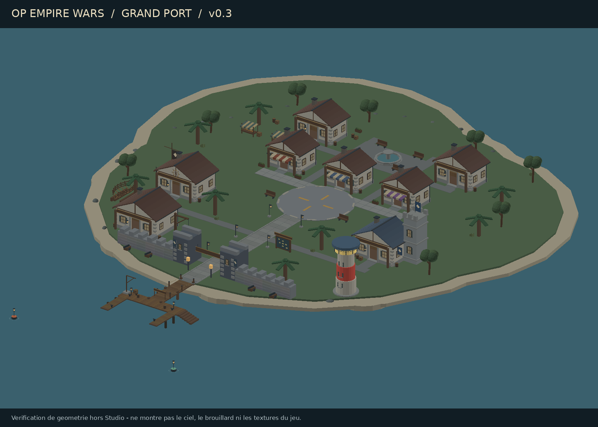

# OP Empire Wars — première map

Jeu Roblox de conquête maritime et de gestion d'îles. Version **0.3 : corrections des bâtiments et ambiance maritime**, avec les côtes de la première maquette conservées. Direction : ports fortifiés, pierre grise, bois vieilli, ardoise, lumière douce et mer brumeuse. L'image de référence guide la séparation des îles, leurs thèmes et leur lisibilité ; les formes restent originales.

## Ouvrir dans Roblox Studio

1. Depuis GitHub, cliquer sur **Code → Download ZIP**, puis extraire le ZIP. Si la branche `main` ne contient qu'un README, sélectionner d'abord la branche `map-v0.1` dans le sélecteur de branche.
2. Dans le dossier extrait, repérer [`studio/OP-Empire-Wars-Map-v0.3.rbxlx`](studio/OP-Empire-Wars-Map-v0.3.rbxlx). C'est la dernière version prête à ouvrir. Le fichier seul peut aussi être téléchargé depuis sa page GitHub avec **Download raw file**. Les versions précédentes sont conservées pour comparaison.
3. Dans Studio, **Fichier → Ouvrir depuis un fichier**, sélectionner ce fichier.
4. La map est visible et modifiable dans `Workspace.Archipelago` avant de jouer.
5. Cliquer sur **Jouer** pour apparaître au centre, créer l'eau native et activer la brume maritime progressive. En édition, le ciel couvert et l'atmosphère côtière sont présents ; le brouillard local en mer s'active uniquement en jeu.

Le modèle seul est également disponible dans `assets/Archipelago.rbxmx`. **Ouvrir la place complète** pour avoir le ciel, les nuages, l'eau et le script client du brouillard. Aucun plugin requis pour ouvrir la place. Ouvrir la v0.3 dans un nouveau document Studio ; ne pas superposer son modèle à une ancienne copie de l'archipel. Conserver à part les éventuelles retouches personnelles avant de changer de version.

[Voir le plan de disposition](docs/Plan-archipel-v0.1.png).



[Vérification des façades et pignons arrière](docs/Grand-Port-v0.3-rear.png). Ces aperçus sont des rendus techniques de la géométrie générée, **pas des captures Roblox Studio** ; ils ne montrent pas ses textures, son ciel ou son brouillard.

Pour Rojo, conserver le dossier complet extrait : ouvrir un terminal dans celui contenant `default.project.json`, installer les outils avec `rokit install` si Rokit est disponible, puis lancer `rojo serve default.project.json`. Garder le terminal ouvert et connecter le plugin Studio à `localhost:34872`. Le plugin seul ne lance pas le serveur. Le fichier dans `studio/` est une livraison figée ; les prochains changements synchronisés utilisent les sources, pas ce fichier place.

## Contenu

- Grand Port : spawn, boutiques d'armes/armures/fruits, marché, missions/tutoriel, quartiers Marine et Pirate, chantier naval, phare, avenue, remparts et quais.
- 4 îles débutantes, 5 intermédiaires, 4 avancées, avec côtes variées, thèmes, ports et 52 parcelles visuelles au total.
- Eau native au lancement, ciel couvert de milieu d'après-midi et streaming activé.
- Modèles construits avec des primitives Roblox, sans assets tiers.

### Détails ajoutés à Grand Port en v0.2

- Façades à colombages et soubassements en pierre, toitures à rangées d'ardoise, pignons, gouttières, cheminées, fenêtres à croisillons et volets, enseignes physiques et auvents.
- Présentoirs d'épées et d'armures, paniers de fruits, comptoirs, étagères, étals de marché et enclume.
- Tour de signal Marine, mât et roue maritime de la guilde, bannières et détails des remparts ; canons purement décoratifs.
- Rues pavées et bordures, place à motif de boussole, fontaine décorative, bancs, lanternes et panneau maritime physique.
- Quais habillés de planches, cordages, bollards, défenses de bois, tonneaux et cargaisons ; grues statiques et coque en construction au chantier.
- Jardinières, arbres, herbes côtières et rochers. Les petites décorations ne bloquent pas les personnages ni les raycasts.
- Atmosphère, correction colorimétrique et halo discret des lumières. Budget : moins de 4 000 pièces pour tout l'archipel, au plus 16 lumières ponctuelles ; performances réelles à mesurer sur mobile.

Cette passe porte sur **Grand Port**. Les 13 autres îles restent des maquettes thématiques ; leurs côtes et leurs parcelles n'ont pas été déplacées.

### Corrections et ambiance v0.3

- Profil de toiture partagé par les **11 bâtiments** : deux versants, faîtage, pignons avant **et arrière**, raccords calculés depuis une même pente ; fermeture du dessus des portes. Façades arrière du hub avec fenêtres et soubassements.
- Murs de courtine coupés au droit des tours, créneaux hors des tours et parements décalés de leurs supports : suppression des recouvrements responsables des scintillements montrés sur les captures.
- Intersections des chemins secondaires fusionnées sans faces coplanaires ; place légèrement surélevée et incrustations séparées des surfaces de support.
- Lumière plus lisible, ombres adoucies, enduits moins bruts, ciel natif avec nuages, horizon plus froid et mer plus claire.
- Brouillard client progressif selon la distance aux 14 îles et à leurs quais, même si les îles lointaines ne sont pas chargées par le streaming. Brume de mer basse et légère ; particules désactivées aux qualités graphiques 1 à 3. Retour à l'atmosphère côtière à la réapparition.
- Bouées d'approche du port et petits sillages décoratifs. Aucun système de navigation ou de météo de gameplay ajouté.

[Détails des corrections et validation](docs/Corrections-v0.3.md).

Les commerces, panneaux et parcelles sont des **emplacements et décors**. Pas encore de bateaux pilotables, capture, économie, carte interactive, combats, protection PvP, races ou factions jouables. Les bonus d'île sont des données de conception sans effet actuel.

## Développement

Python 3 (bibliothèque standard) et Rojo **7.6.1** sont nécessaires. `rokit.toml` épingle Rojo pour les postes équipés de Rokit (`rokit install`). Le binaire testé dans le cloud est `/workspace/tooling/rojo-7.6.1/rojo`.

Depuis la racine du dépôt :

```sh
python3 tools/build_map.py
python3 -m unittest discover -s tools -p 'test_*.py' -v
mkdir -p build
rojo build default.project.json -o build/OP-Empire-Wars-Map-v0.3.rbxlx
```

Si `rojo` n'est pas dans le PATH, utiliser son chemin cloud ci-dessus. Pour la synchronisation avec le plugin Rojo officiel de Studio : `rojo serve default.project.json`.

Pour régénérer, exécuter les contrôles, construire et actualiser la copie dans `studio/` en une commande : `python3 tools/build_release.py`. Le rendu optionnel `tools/render_harbor.py` utilise NumPy et Pillow ; ces dépendances ne sont pas nécessaires pour générer la map ou ouvrir Studio.

- `tools/world.json` : positions, tailles, thèmes, difficultés et bonus prévus.
- `tools/build_map.py` : générateur déterministe du modèle.
- `tools/harbor_details.py` : composition et détails de Grand Port.
- `tools/roofing.py` : profil de toiture et pignons communs à tous les bâtiments.
- `assets/Archipelago.rbxmx` : modèle généré inclus par Rojo.
- `src/server/Ocean.server.luau` : eau native au lancement.
- `src/client/MaritimeWeather.client.luau` : transitions atmosphériques et brume locale.
- `src/shared/WorldEnvironment.luau` : géographie du brouillard générée depuis `tools/world.json`.
- `docs/Cahier-des-charges-V6.md` : référence fournie par le porteur du projet.
- `docs/Projet.md` : décisions et prochaine étape.

**Régénérer écrase le modèle généré.** Conserver les retouches Studio séparément avant régénération ou synchronisation ; reporter les changements durables dans le générateur. Ce flux ne sauvegarde pas automatiquement les retouches Studio.

## Validation

Vérifié dans le cloud : douze contrôles de structure et disposition, dont fermetures des pignons et absence des recouvrements corrigés ; tests Luau de la géographie et du cycle de vie du brouillard ; compilation Luau et construction de la place avec Rojo. Les bases des îles restent identiques à la v0.1. **Roblox Studio n'est pas disponible ici : aucun test de jeu natif n'a été exécuté.**

Avec le CLI Luau officiel (testé en 0.699), exécuter aussi :

```sh
luau tools/test_weather.luau
python3 tools/check_weather_client.py luau
```

Le deuxième contrôle exécute le véritable script client dans une simulation des API Roblox pour tester ses transitions, réglages et nettoyages. Il ne valide pas le rendu du moteur, les textures intégrées ou les particules réelles.

À vérifier dans Studio : apparition, accès aux boutiques et au quai, nage et escalier de sortie d'eau, collisions des côtes, visibilité et streaming sur mobile. Les distances seront ajustées après réalisation du premier bateau. Aucun accès API ni DataStore nécessaire pour cette version.
